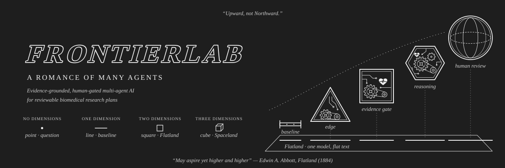
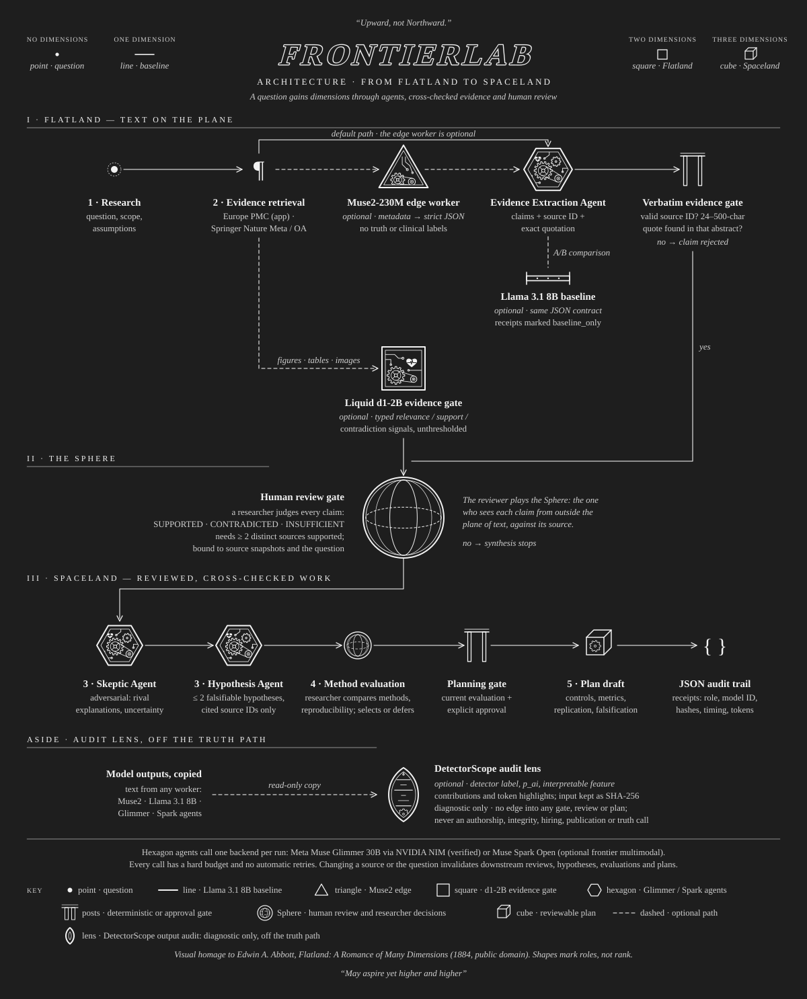
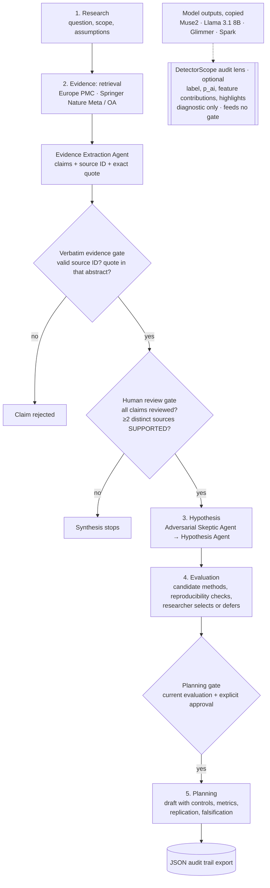

<p align="center">
  
</p>

# FrontierLab
### Evidence-grounded multi-agent AI for scientific research

**Meta Global AI Developer Hackathon 2026 · Indie Developer Track · Push the Frontier**

FrontierLab helps a researcher turn a scientific question into a falsifiable hypothesis and a reviewable research plan. Every claim must cite and quote its source, and nothing moves forward until a human has reviewed it.

**Codebase: v0.35 candidate · Status reviewed: October 29, 2026 (Asia/Taipei)**

[Hosted Space](https://huggingface.co/spaces/Jaycee766/FrontierLab-Meta-Hackathon-2026) · [Project charter](docs/ORIGINAL_PROJECT_CHARTER.md) · [Demo runbook](docs/DEMO_RUNBOOK.md) · [Submission copy](docs/SUBMISSION_COPY.md) · [Release checklist](docs/RELEASE_CHECKLIST.md) · [Final sprint](docs/HACKATHON_FINAL_SPRINT.md) · [Changelog](CHANGELOG.md) · [Tests](https://github.com/Jaycee871/FrontierLab-Meta-Hackathon-2026/actions/workflows/tests.yml)

---

## The problem

When an LLM writes about scientific literature, it can cite a real DOI and still make a statement the paper never supports. Its output can also sound more certain than the evidence is. Most literature assistants jump from search straight to synthesis. They don't show what each source actually says, where the sources disagree, or where a researcher needs to step in.

FrontierLab treats literature-to-plan work as an **auditable, human-gated pipeline**. Model agents propose claims, critiques, hypotheses and plans. Deterministic checks and explicit researcher decisions decide what moves forward. The initial domain is biomedical research, with a focus on whether a protein-design method merits further testing.

It follows four principles: **transparent evidence, reproducibility, uncertainty analysis and meaningful researcher intervention.**

## Key features

- **Five-stage workflow** (Research → Evidence → Hypothesis → Evaluation → Planning) in a Streamlit interface.
- **Literature discovery** from Europe PMC (used by the app), plus a separate three-source workflow that adds Springer Nature Meta API v2 and Springer Nature Open Access API.
- **Verbatim evidence gate.** Every model claim must cite a retrieved source ID and include a contiguous, verbatim 24–500-character quotation from that paper's abstract. Claims that fail are rejected before synthesis.
- **Human review gate.** Each accepted claim needs a reviewer verdict: SUPPORTED, CONTRADICTED or INSUFFICIENT. Synthesis resumes only when every claim is reviewed and at least two distinct papers are judged supportive. Reviews are bound to source snapshots and the research question.
- **Multi-agent synthesis with Meta Muse Glimmer 30B** (`meta/muse-glimmer-30b`) through NVIDIA NIM. Roles include the Evidence Extraction Agent, Adversarial Skeptic Agent and Hypothesis Agent, plus optional method-proposal and planning calls. Every call has a hard budget, and there are no automatic retries.
- **Method evaluation.** The researcher compares candidate methods and records reproducibility documentation (data, code, environment, parameters, protocol, metrics) and uncertainty. They then select a method with a rationale or defer.
- **Planning readiness + approval gate.** A deterministic pre-planning contract first verifies that the human review, hypotheses and selected Method Evaluation are still current. It carries M2's open reproducibility checks and required validation/interpretation obligations forward without calling a model. A draft plan still requires the separate explicit researcher approval checkbox.
- **Evidence graph.** Each run builds a plain-dict provenance graph (Paper ← Passage ← Claim ← Hypothesis ← Plan step). Every edge is tagged EXTRACTED (quote located in the abstract, or a checked ID reference), INFERRED (model stance without an anchored quote) or AMBIGUOUS (conflicting labels). A plan step can be approved only if its whole path back to a paper is EXTRACTED. The graph can be downloaded as `graph.json`. See [evidence graph](docs/EVIDENCE_GRAPH.md).
- **Audit trail export.** Source records, claim checks, review judgments, workflow decisions and drafts can be exported as JSON with per-request model receipts (role, model ID, input/output hashes, timing, tokens), normalized human-intervention events, deterministic process metrics and an error-taxonomy summary.
- **Human-intervention event stream.** Consequential researcher actions are timestamped and bound to workflow artifacts (claim review saved, method evaluation saved, planning approved, plan-step approved). Identity is recorded as an actor label but is not cryptographically verified.
- **Process metrics.** SCR, recorded human-intervention counts, NIM AERR semantics, token/latency totals and process error classes are derived deterministically from the run state. These are workflow metrics, not scientific-accuracy scores.
- **Error taxonomy.** Governance gates, insufficient evidence, citation/source failures, missing resources, model runtime failures, rejected claims and scientific tensions are separated instead of collapsing every non-success state into one error bucket.
- **Trajectory audit graph.** A separate audit-only graph records the five-stage workflow, model-call receipts, human-intervention events, method evaluation, rejected claims and process signals. It is exported as `trajectory.json` and never participates in the scientific evidence gate.
- **Controlled gate ablation.** FrontierLab separates a zero-call post-generation replay from a true same-model/same-cases prompt-level experiment. The recorded 12-case Glimmer batch currently shows 8 decisive outputs and 4 abstentions; all 8 decisive outputs already had valid anchored quotes, so the post-processing source/quote gate added 0 new abstentions. This is not reported as accuracy because independent gold is unavailable. A manual two-call Glimmer workflow is prepared for the genuine prompt-level comparison.
- **12-case researcher review workspace.** The app can download the source-bound reviewer packet and accept an edited JSON packet back through a file uploader. Source/case fields are revalidated, completed judgments require rationales, reviewer identity is recorded as an unverified label, and Arm C is recomputed immediately without a new model call. Researcher review is never relabeled as independent gold.
- **M2 Stage-5 readiness contract.** The selected M2 path now produces a zero-call readiness packet with exact context/evaluation IDs, reviewed source sets, the three open reproducibility checks (data/code/environment) and nine required planning obligations including monomeric-Fab SPR, avidity/stoichiometry handling, search-bias disclosure, replication and falsification. The packet explicitly keeps `planning_approved=false` and `model_call_authorized=false`.
- **Invalidation on change.** If source records or the question change, earlier reviews, hypotheses, evaluations and plans are invalidated.

## Architecture

<p align="center">
  
</p>

**From Flatland to Spaceland.** One model on its own sees only flat text. FrontierLab adds dimensions: several bounded agents, evidence that is cross-checked against its source, and a researcher who reviews each claim from outside the text, as the Sphere shows A. Square the third dimension. Each shape stands for a role. The shapes mark what a component does, not how important it is.

| Shape | Role in FrontierLab |
| --- | --- |
| Point | The research question (Stage 1) |
| Line segment | Meta Llama 3.1 8B Instruct: optional local baseline that runs the same JSON contract for comparison (`frontierlab/llama31_baseline.py`) |
| Triangle | Muse2-230M: optional edge worker for metadata normalization and strict JSON (`frontierlab/muse2_edge.py`) |
| Square | Liquid AI d1-2B: optional multimodal evidence gate for figures, tables and images (`frontierlab/multimodal_evidence.py`) |
| Hexagon | Reasoning agents (Evidence Extraction, Adversarial Skeptic, Hypothesis) on Meta Muse Glimmer 30B via NVIDIA NIM, or optionally Muse Spark Open (`frontierlab/muse_spark_open.py`) |
| Gate posts | Deterministic or approval gates: verbatim evidence gate and planning gate |
| Sphere | Human review gate and other researcher decisions (claim review, method selection) |
| Cube | The reviewable research plan (Stage 5) |
| Lens | DetectorScope: optional, diagnostic-only output-audit lens that reads copies of model outputs and reports interpretable detector features (`frontierlab/detectorscope_audit.py`). It sits off the truth path and feeds no gate, review or plan |

Dashed lines in the diagram mark optional paths. The DetectorScope lens is drawn in a separate aside below Stage 5 because it is not a pipeline step: it has an input from model outputs and no edge back into any gate. The dimension markers at the top follow the lift from a point (the question) through a line and a square to a cube (the reviewed plan).

<details>
<summary>Text version of the pipeline (Mermaid)</summary>



</details>

| Stage | Researcher-facing goal | Current implementation |
| --- | --- | --- |
| **1. Research** | Define the scientific question, scope and assumptions. | Question and literature-query inputs in Streamlit. |
| **2. Evidence** | Retrieve papers and inspect citation-linked claims, quotations and disagreement. | Europe PMC retrieval; separate three-source discovery workflow; source and quotation checks. |
| **3. Hypothesis** | Propose falsifiable hypotheses grounded in reviewed evidence. | **Real reviewed continuation completed.** After human review, two Meta Muse Glimmer calls produced two citation-linked hypotheses and a skeptical uncertainty analysis. The execution boundary was validated. |
| **4. Evaluation** | Compare candidate methods, reproducibility conditions and uncertainty. | **Researcher decision completed.** M2 selected; M1 retained as comparator. The canonical evaluation is bound to the exact live hypothesis trace and passes `require_evaluation()`. Open reproducibility checks remain for data, code and environment. |
| **5. Planning** | Approve a draft with controls, measurements and falsification criteria. | Requires a current method evaluation and explicit approval. Exports the selected method, rationale, unresolved checks and draft controls, metrics, replication and falsification criteria. Live inference for this stage is unverified. |

Core modules live in [`frontierlab/`](frontierlab): `pipeline.py` (research pipeline), `evidence.py` / `claim_verification.py` (quotation and source checks), `review.py` (human review packets), `evidence_graph.py` (provenance graph and plan-step path gate), `evaluation.py` / `evaluation_ui.py` (method evaluation), `research_backend.py` / `nvidia_muse.py` / `openweight.py` (model backends), `discovery.py` / `multisource.py` / `springer_meta.py` / `springer_oa.py` (retrieval), and `audit.py` / `reporting.py` (export).

## Quickstart

Requires **Python 3.10+**.

### 1. Install

```bash
git clone https://github.com/Jaycee871/FrontierLab-Meta-Hackathon-2026.git
cd FrontierLab-Meta-Hackathon-2026
python -m pip install -r requirements.txt
```

### 2. Configure (optional)

No keys are needed for the synthetic demo or Europe PMC retrieval. Model-backed and publisher features are **off by default**. Set the following on the server that runs the app, using environment variables or the host's secret settings. Never put keys in the repository or in the research question.

| Variable | Used for |
| --- | --- |
| `NVIDIA_API_KEY` | NVIDIA NIM access to Meta Muse Glimmer. |
| `FRONTIERLAB_NIM_RESEARCH=YES` | Owner opt-in that enables the **Meta via NVIDIA** research mode. |
| `SPRINGER_NATURE_META_API_KEY` | Springer Nature Meta API v2. This is a bibliographic metadata API, not Meta Platforms model inference. `META_API_KEY` is accepted as a fallback. |
| `SPRINGER_NATURE_OA_API_KEY` | Springer Nature Open Access API. `Open_Access_API` is accepted as a fallback. |
| `FRONTIERLAB_NVIDIA_TRIAL`, `FRONTIERLAB_META_JSON_TRIAL`, `FRONTIERLAB_META_PILOT_TRIAL`, `FRONTIERLAB_EXTRACTION_TRIAL`, `FRONTIERLAB_CONTINUATION_TRIAL` | Explicit `YES` opt-ins for the bounded trial scripts in `scripts/`. |
| `FRONTIERLAB_DOWNLOAD_OK=YES` | Allows `scripts/start_muse_local.sh` to download the ~17 GB local checkpoint. |
| `HF_TOKEN1`, `FRONTIERLAB_HF_DEPLOY=YES` | Used only by the Hugging Face deploy script. |
| `GITHUB_SHA`, `GITHUB_RUN_ID`, `GITHUB_RUN_ATTEMPT` | Set automatically by GitHub Actions and recorded in run receipts; don't set them by hand. |

[`.env.example`](.env.example) lists every variable, grouped and commented. The app does not load `.env` files automatically, so export the variables or use your host's secret settings. GitHub Secrets are **not** automatically available inside Hugging Face Spaces. See the [NIM research backend](docs/NIM_RESEARCH_BACKEND.md) and [resource strategy](docs/RESOURCE_STRATEGY.md) docs.

### 3. Run the app

```bash
streamlit run app.py
```

On Windows, double-click `run_windows.bat`. It installs `requirements.txt` and starts Streamlit.

Choose a mode in the sidebar:

| Mode | What it does | Requirements |
| --- | --- | --- |
| **Synthetic audit demonstration** | Uses labeled, hand-authored fictional publications to show disagreement, approval and planning. | No keys, model or external calls. |
| **Live Europe PMC metadata (no model calls)** | Retrieves real publication metadata and available abstracts. | Internet connection; no API key. |
| **Live Europe PMC + local Meta model** | Attempts model-based claim extraction and the human-reviewed synthesis workflow. | A real Muse Glimmer checkpoint served by llama.cpp on the same host at `127.0.0.1:8080` (see `scripts/start_muse_local.sh`). Experimental and unverified. |
| **Live Europe PMC + Meta via NVIDIA** | Reuses one NIM research client across extraction, reviewed synthesis, method proposals and planning. | Owner-enabled backend, server-side credential, explicit consent to send the question and abstracts, and a shared cap of eight attempted calls per server process. [Setup](docs/NIM_RESEARCH_BACKEND.md). |

To try the full five-stage flow without a model, run the **Synthetic audit demonstration**. Then follow the walkthrough in [method evaluation and planning](docs/METHOD_EVALUATION.md#try-both-paths-without-a-model).

### 4. Run tests

```bash
python -m pip install -r requirements-dev.txt
python -m pytest -q
```

The v0.35 candidate suite has **348 tests**. It covers the five-stage workflow, human-review/evaluation invalidation, model-adapter boundaries, evidence-graph schema v2 integrity, human-intervention events, process metrics, error taxonomy, trajectory audit graph, gate-ablation/reviewer-packet contracts, and deterministic Stage-5 planning readiness. GitHub Actions run [40920928261](https://github.com/Jaycee871/FrontierLab-Meta-Hackathon-2026/actions/runs/40920928261) passed all 348 tests after the readiness-panel integration. Normal tests make no model calls. **The test count is not a model-accuracy score.**

Optional offline demonstrations:

```bash
python -m scripts.research_failure_lab
python -m scripts.bionemo_preflight
python -m scripts.lobster_guard_demo
python -m scripts.detectorscope_preflight
python -m scripts.real_literature_benchmark --kind evaluate --predictions docs/runs/meta_pilot_predictions_20261028.json
```

## Deployment (Hugging Face Space)

- **Space:** https://huggingface.co/spaces/Jaycee766/FrontierLab-Meta-Hackathon-2026. This is a public Docker Space on CPU Basic. Template: [`deploy/hf-space/`](deploy/hf-space).
- **Status:** v0.16 deployed and verified RUNNING. The runtime revision, health endpoint (HTTP 200) and rendered source marker were checked, and both recorded claim judgments with their rationales are visible. [Deployment receipt](docs/runs/hf_deployment_20261028.json).
- **How it deploys:** the manual `Deploy FrontierLab to existing HF Space` workflow (`.github/workflows/deploy-hf-space.yml`) runs the test suite. It then calls `python -m scripts.deploy_hf_space`, which uploads a fixed source snapshot plus a `deployment.json` holding the source SHA and asset hashes. It updates only the existing Space and does not change hardware. Docker builds don't clone a moving branch.
- **Limits:** the CPU Space hosts the interface and the retrieval and audit tools. It has no loaded Muse Glimmer model, and NIM inference is owner-disabled there. No NVIDIA credential is transferred. A remote Kaggle server is not reachable through the Space's localhost address.

Details: [HF deployment](docs/HF_DEPLOYMENT.md) · [HF Space setup](docs/HF_PRO_SETUP.md) · [local / open-weight inference notes](docs/META_OPENWEIGHT_HF_CPU.md).

## Evaluation and recorded results

All numbers below come from dated run records in [`docs/runs/`](docs/runs) and the linked GitHub Actions runs. No billed Meta Platforms Model API was used.

| Component | Recorded result | Scope / limits |
| --- | --- | --- |
| **Meta inference smoke test** | One synthetic request to `meta/muse-glimmer-30b` via NVIDIA NIM: `finish_reason=stop`, 10.535 s, 249 tokens. [Run 40562188386](https://github.com/Jaycee871/FrontierLab-Meta-Hackathon-2026/actions/runs/40562188386) · [receipt](docs/runs/meta_nim_smoke_20261028.json) | Synthetic prompt only. |
| **Structured JSON check** | One published-excerpt strict-JSON response passed expected-ID and exact-quotation checks: 5.126 s, 526 tokens. [Run 40563411852](https://github.com/Jaycee871/FrontierLab-Meta-Hackathon-2026/actions/runs/40563411852) · [receipt](docs/runs/meta_nim_json_20261028.json) | Single case. |
| **12-case literature pilot batch** | 12 structured predictions in one joint context: 8 quote-anchored SUPPORTED/CONTRADICTED responses and 4 INSUFFICIENT abstentions; 11.168 s, 1,794 tokens. [Run 40563954658](https://github.com/Jaycee871/FrontierLab-Meta-Hackathon-2026/actions/runs/40563954658) · [receipt](docs/runs/meta_nim_pilot_20261028.json) · [predictions](docs/runs/meta_pilot_predictions_20261028.json) | Human reference labels are pending, so **accuracy is null**. This is not a generalization benchmark. [Details](docs/META_STRUCTURED_RUNS.md). |
| **Core extraction** | Two real Evidence Extraction Agent calls (1,802 tokens) on frozen published excerpts. Two quoted claims passed the passage checks, and the run stopped at `HUMAN_CLAIM_REVIEW_REQUIRED`. [Run 40566722171](https://github.com/Jaycee871/FrontierLab-Meta-Hackathon-2026/actions/runs/40566722171) · [receipt](docs/runs/nim_research_extraction_20261028.json) | Fixed sources; not a fresh live search. |
| **Human claim review** | Jaycee871 reviewed both core claims as SUPPORTED with written rationales. [Review record](docs/runs/nim_claim_review_completed_20261028.json) | Reviewer decisions, not adjudicated ground truth. |
| **Reviewed continuation** | After the review, exactly two Muse Glimmer roles (Adversarial Skeptic Agent → Hypothesis Agent) returned validated JSON, used 2,317 tokens, and produced two citation-linked hypotheses that survived the audit. [Run 40574846326](https://github.com/Jaycee871/FrontierLab-Meta-Hackathon-2026/actions/runs/40574846326) · [summary](docs/runs/nim_reviewed_continuation_20261028.json) · [handoff](docs/runs/nim_method_handoff_20261028.json) | Stopped before Evaluation and Planning by design. |
| **Method selection** | The researcher selected **M2: structure-based dual-pH histidine-scanning computational design**, with M1 kept as a comparator. The canonical evaluation passes the Planning eligibility check. [Evaluation](docs/runs/method_evaluation_20261028.json) · [researcher rationale](docs/runs/researcher_method_selection_20261028.json) | No scientific execution is claimed. Planning is **not yet approved or generated**. |
| **Three-source discovery** | Europe PMC, Springer Nature Meta API v2 and Springer Nature Open Access each returned two records: six in total, four with abstracts. [Run 40519989268](https://github.com/Jaycee871/FrontierLab-Meta-Hackathon-2026/actions/runs/40519989268) | The Streamlit app currently uses only Europe PMC. |
| **BioNeMo** | Offline preflight only: Boltz-2 request preparation and response-format checks. | No hosted scientific computation has run. |

Earlier evidence: [171-test run](https://github.com/Jaycee871/FrontierLab-Meta-Hackathon-2026/actions/runs/40560343730).

### Agentic-autonomy self-assessment

Using the six-level framing summarized from Zhao et al. (npj Drug Discovery, 2026), FrontierLab is a **Level 1 Assisted Pipeline by design**. Models fill fixed roles, but code and the researcher control stage transitions; the verified NIM path has no automatic retry; and critical scientific progression remains human-gated. This is not a claim of autonomous-scientist behavior.

See [agentic-AI landscape and self-assessment](docs/AGENTIC_AI_LANDSCAPE.md) for the topology, validation boundaries, schema-v2 traceability mapping and remaining process-metric gaps.

### Important limitations

- **A matching quotation shows that the text exists in a source. It does not show that the text supports the model's interpretation.**
- Human labels are review decisions, not independently adjudicated scientific ground truth.
- Conflict detection depends on model-supplied claim keys, which can be wrong.
- Outputs are research drafts. FrontierLab has no validated clinical or wet-lab execution capability.
- Paid Meta Model API access is disabled.

See the [verbatim evidence gate](docs/VERBATIM_EVIDENCE_GATE.md), the [human review protocol](docs/HUMAN_REVIEW_GATE.md), [method evaluation and planning](docs/METHOD_EVALUATION.md), and [process metrics](docs/PROCESS_METRICS.md), [trajectory audit graph](docs/TRAJECTORY_GRAPH.md), [gate ablation](docs/GATE_ABLATION.md), and [planning readiness](docs/PLANNING_READINESS.md).

## Model roles

FrontierLab deliberately separates model capability from scientific governance:

- **Meta Muse Glimmer 30B** — verified stable research backend with recorded real inference through NVIDIA NIM.
- **Meta Muse Spark Open** — optional frontier multimodal backend with provider-specific capability enforcement. Together is the preferred first live Spark path for full text/image/audio/video serverless; Fireworks is retained as an image-first serverless fallback.
- **Liquid AI d1-2B** — optional lightweight typed multimodal evidence verifier for localization/extraction/decision signals.
- **Muse Research Muse2-230M** — optional edge/on-device structured worker for metadata normalization, log-to-JSON, schema formatting and routing. It is explicitly blocked from scientific entailment or clinical truth judgments.
- **Meta Llama 3.1 8B Instruct** — optional medium-size local general-purpose baseline / worker. It can run the same bounded structured JSON contract for controlled comparisons, but every receipt is marked baseline-only and cannot bypass scientific governance.
- **DetectorScope** — optional explainability / output-audit lens for inspecting interpretable detector features, contributions and token highlights across model outputs. It is diagnostic-only and explicitly forbidden for academic-integrity, hiring, publication, authorship or scientific-truth decisions.

All model layers remain subordinate to the same evidence, human-review, stale-context, method-selection and planning gates. A more capable model does not bypass the research governance layer.

### Model-scale ladder

| Model | Approx. scale | FrontierLab role |
| --- | ---: | --- |
| Muse2-230M | 0.23B | Edge structured preprocessing |
| Llama 3.1 8B Instruct | 8B | Local general-purpose baseline / worker |
| Muse Glimmer 30B | 30B | Verified scientific reasoning backend |
| Muse Spark Open | 816B total / 42B active | Frontier multimodal reasoning backend |
| DetectorScope | Not a rung (diagnostic layer) | Interpretable linguistic-feature audit across the rungs' outputs; diagnostic only |

The planned comparison is not a size leaderboard. The goal is to measure the smallest model that can reliably perform each bounded task under the same evidence and human-review constraints.

## Supporting experiments and tools

- [DetectorScope Explainability / Output Audit Lens](docs/DETECTORSCOPE_AUDIT.md) — optional diagnostic analysis of AI-text detector features and highlights across model outputs; no real DetectorScope inference has been executed in FrontierLab.

- [Llama 3.1 8B Local Baseline Worker](docs/LLAMA31_BASELINE.md) — optional medium-size text baseline for structured reliability/cost comparisons; no new Llama 3.1 inference has been executed in FrontierLab.

- [Muse2-230M Edge Structured Worker](docs/MUSE2_EDGE_WORKER.md) — optional local preprocessing for strict JSON/metadata/routing; no real Muse2 inference has been executed in FrontierLab.

| Module | Purpose | Current boundary |
| --- | --- | --- |
| [Real literature pilot](docs/REAL_LITERATURE_PILOT.md) | Twelve excerpt-level cases from four published papers; blank reviewer packets and comparison of imported outputs. | One real Meta batch is recorded. Reference labels are AI-authored proposals awaiting researcher review. No accuracy claim. |
| [Claim-to-passage audit](docs/CLAIM_VERIFICATION_AND_NIM.md) | Separates source identity, quotation matching and semantic-label agreement. | Ten hand-authored fictional cases; not measured Meta model performance. |
| [Research Failure Lab](docs/RESEARCH_FAILURE_LAB.md) | Exercises stale reviews, misattributed quotations, spoofed tool results and other handoff failures. | Twelve fictional software scenarios; not a biological or human-participant study. |
| [BioNeMo tools](docs/BIONEMO_SCIENCE_TOOLS.md) | Prepares an optional scientific-computation step within Evaluation. | Protein-only Boltz-2 preflight and response-shape checks. ProteinMPNN, RFdiffusion and OpenFold3 are listed but not connected. |
| Quantitative heterogeneity example | Illustrates disagreement using inverse-variance estimates, Cochran Q and I². | Fictional inputs; Python results were cross-checked with Wolfram during development. |
| [OpenCode](docs/OPENCODE_DEVELOPER.md) / [OpenShell exploration](docs/OPENCLAW_OPENSHELL.md) | Support local development and isolation experiments. | OpenCode configuration and simulated permission checks; real OpenShell runtime isolation is unverified. |
| [Legacy Facebook Research MUSE](docs/LEGACY_MUSE_MULTILINGUAL.md) | Historical cross-lingual embedding alignment reference for a future multilingual Evidence layer. | Archived upstream project, distinct from Meta Muse Glimmer; no upstream code or data is bundled or executed. |

These modules support the five-stage product. Their offline results do not show successful Meta inference or scientific discovery. DetectorScope is outside the scientific truth path: it audits output characteristics but cannot approve or reject claims, authors, papers or people.

**Muse naming note:** the archived Facebook Research **MUSE** project (Multilingual Unsupervised and Supervised Embeddings) is a separate, legacy research project. It is unrelated to **Meta Muse Glimmer 30B**, and it is not part of the current runtime.

## Project layout

| Path | Contents |
| --- | --- |
| `app.py` | Streamlit interface, claim review and export controls. |
| `frontierlab/` | Retrieval, audit rules, review packets, model adapters, research pipeline and supporting experiments. |
| `scripts/` | Offline demonstrations, hardware checks, opt-in connection trials and the HF deploy script. |
| `tests/` | Offline software tests (pytest). |
| `datasets/` | Published-excerpt pilot cases with citation and rights metadata. |
| `deploy/hf-space/` | Docker Space template (Dockerfile and Space README). |
| `docs/` | Charter, protocols, resource notes and sprint plan; dated run records in `docs/runs/`. |
| `.github/workflows/` | Automated tests (`tests.yml`) and manual-only connection, trial and deploy workflows. |
| [CHANGELOG.md](CHANGELOG.md) | Version-by-version development history. |

Key docs: [project charter](docs/ORIGINAL_PROJECT_CHARTER.md) · [final sprint plan](docs/HACKATHON_FINAL_SPRINT.md) · [NIM research backend](docs/NIM_RESEARCH_BACKEND.md) · [method evaluation](docs/METHOD_EVALUATION.md) · [verbatim evidence gate](docs/VERBATIM_EVIDENCE_GATE.md) · [human review gate](docs/HUMAN_REVIEW_GATE.md) · [evidence graph](docs/EVIDENCE_GRAPH.md) · [agentic-AI landscape and self-assessment](docs/AGENTIC_AI_LANDSCAPE.md) · [structured Meta runs](docs/META_STRUCTURED_RUNS.md) · [HF deployment](docs/HF_DEPLOYMENT.md) · [resource strategy](docs/RESOURCE_STRATEGY.md) · [Springer Nature Meta API](docs/SPRINGER_NATURE_META.md) · [Springer Nature Open Access](docs/SPRINGER_NATURE_OA.md).

Some setup documents keep earlier implementation snapshots. To judge what has actually been verified, use the dated status and run records linked above.

## Hackathon context and next milestones

FrontierLab was built for the [Meta Global AI Developer Hackathon](https://cerebralvalley.ai/e/meta-ai-developer-hackathon) 2026, Indie Developer Track, under the Push the Frontier theme. Competition-period implementation began on **October 27, 2026**. The [original project charter](docs/ORIGINAL_PROJECT_CHARTER.md) defines the five-stage contract and the four principles.

1. **Stage 5 is still human-gated.** M2 is formally selected, but Planning has not been approved or generated.
2. **Complete one live five-stage case:** question, literature, human-reviewed claims, hypothesis, evaluation and approved plan.
3. **Run a controlled comparison.** Use the same model and cases to compare three setups: no gate, source/quote checks, and checks plus human review. Report abstention and intervention separately.
4. **Record the public demo.** v0.16 is deployed with a checked revision. Record a roughly three-minute demonstration of actual behavior.
5. **Submit the entry.** Check the participant portal's current requirements and complete the formal submission.

See the [final sprint plan](docs/HACKATHON_FINAL_SPRINT.md). Publishing the repository and hosting a demo do not count as formal submission.

## License

The original code and documentation are released under the [MIT License](LICENSE), copyright (c) 2026 Pack Kwan Low (Jaycee871). Third-party material keeps its own terms; see [NOTICE](NOTICE). This includes the published excerpts in `datasets/`, which stay under their original licenses, as well as Meta Muse Glimmer (Apache 2.0, not bundled), Liquid AI d1/LFM models (LFM Open License v1.0, not bundled), Meta Llama 3.1 8B Instruct (Llama 3.1 Community License and Acceptable Use Policy, not bundled), Muse Research Muse2-230M (Apache 2.0, not bundled), the optional DetectorScope package (Apache 2.0) and its Gemma-based detector checkpoints (Gemma terms; neither is bundled or installed by default) and the referenced legacy MUSE project (CC BY-NC 4.0, not included).

## Credits

Created by **Pack Kwan Low (Jaycee)**.

- [Meta Global AI Developer Hackathon](https://cerebralvalley.ai/e/meta-ai-developer-hackathon)
- [Meta developer platform](https://dev.meta.ai/)
- Literature data: Europe PMC and Springer Nature APIs. The pilot excerpts carry their own citation and rights metadata in [`datasets/`](datasets/real_ph_excerpt_cases_v1.json).
- Evidence-graph provenance tags (EXTRACTED / INFERRED / AMBIGUOUS) are inspired by [Graphify](https://github.com/Graphify-Labs/graphify) (Graphify Labs, Apache-2.0). This is an idea credit only; no Graphify code is used or bundled.
- Autonomy framing: Zhao D., Fang M., Mao L. et al., *The rise of agentic AI in drug discovery: from static tools to autonomous virtual scientists*, npj Drug Discovery 3, 43 (2026), DOI 10.1038/s44386-026-00075-0. FrontierLab summarizes the framework in its own words.
- Visual theme: an homage to Edwin A. Abbott's *Flatland: A Romance of Many Dimensions* (1884, public domain). The epigraphs "Upward, not Northward" and "May aspire yet higher and higher" are quoted from the book (Project Gutenberg eBook #97). All artwork is original.
